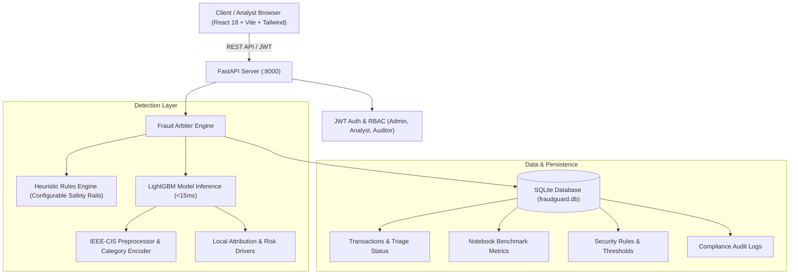

# FraudGuard AI — System Architecture

FraudGuard AI is an enterprise financial fraud detection and risk scoring platform built directly upon the research findings of the **IEEE-CIS Fraud Detection Modeling** benchmark.

## Core Components
1. **Frontend (Vite + React 18 + Tailwind CSS + Lucide Icons + Recharts)**:
   - Real-time Operations Dashboard with live telemetry stream and volume graphs.
   - Interactive Live Inspector with 4 preset scenario benchmarks (e.g. Micro-charge testing, ATO).
   - Bulk Batch CSV evaluation engine with downloadable sample templates.
   - Model Research Lab directly comparing the 4 notebook methods under chronological split vs CV.
   - Investigation Ledger with analyst decision overrides (Confirm Fraud, False Positive, Dismiss).
   - Rules Engine & Risk Threshold calibration sliders.

2. **Backend (FastAPI + SQLAlchemy + Pydantic v2 + Scikit-Learn + LightGBM)**:
   - High-throughput asynchronous REST API (<15ms scoring latency).
   - Hybrid decision engine: combines rule-based deterministic safety rails with probabilistic ML scoring.
   - Local feature attribution engine (SHAP-approximated impact) providing actionable explanations for every alert.
   - Database auto-seeding with exact benchmark results extracted from `IEEE_CIS_Fraud_Detection_Modeling.ipynb`.
